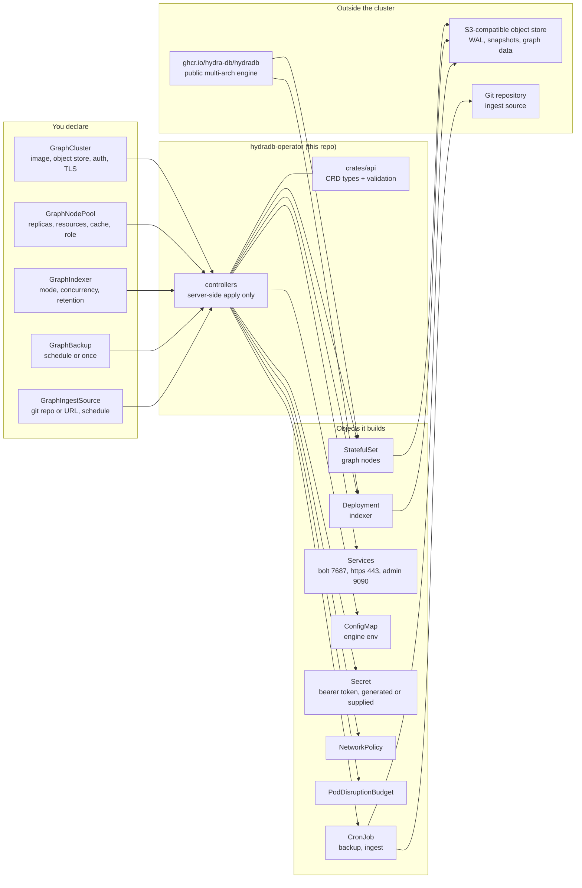

# HydraDB Operator

> [!WARNING]
> **Highly experimental. Not production-ready as it stands.**
>
> This operator runs a real graph database for real traffic in one cluster. It is early work. The
> API is `v1alpha1`. The defaults assume a lab, not a regulated environment. There is no upgrade
> guarantee between releases, no support contract, and no promise that a CRD field keeps its
> meaning.
>
> Treat this code as a starting point. You can adapt it, fork it, or rebuild it. If you can do
> better, please do. That is why we publish it.

<p align="center">
  <a href="LICENSE"></a>
  
  
  
</p>

This operator runs [HydraDB](https://github.com/hydra-db/hydradb) on Kubernetes. HydraDB is a graph
database that keeps its data in object storage. The operator is written with [kube-rs](https://kube.rs/).

The project lives at [git.kubexa.tech/oss/hydradb-operator](https://git.kubexa.tech/oss/hydradb-operator).
Issues, pull requests and CI run there. The copy on GitHub is a mirror, and it carries the releases.

An operator is a program that runs inside the cluster and keeps other objects in the state you
declare. This operator builds every child object in Rust and applies it with server-side apply. It
never starts `helm`. It never resolves `:latest` at run time. It never holds a credential. Your
credentials stay in the Secrets that you name.

## Contents

- [Contributing](#contributing)
- [How it fits together](#how-it-fits-together)
- [Custom resources](#custom-resources)
- [Quickstart](#quickstart)
- [Scope: what this operator is, and is not](#scope-what-this-operator-is-and-is-not)
- [Docs](#docs)
- [License](#license)

## Contributing

This operator is open source. You can use it in any project, for no cost, under the license in
`LICENSE`.

You can send a bug report, a question, or a pull request. You do not need permission first.

- If you found a bug, open an issue. Give the version, the CRD spec, and the result you expected.
- If you want a feature, open an issue first. We can agree on the shape before you write code.
- If you send a patch, keep it small. Add the test that would have caught the bug. Say what you
  tested.

There is one limit that we state plainly. This project continues next to other work. We cannot
promise a date for a review or a merge. We read issues and pull requests. They can wait longer than
they would in a project with paid maintainers. If your problem is urgent, say so in the issue and
explain why. That is the one thing that changes the order.

## How it fits together



The operator holds no state of its own. Each reconcile reads the custom resources, computes the child
objects, and applies them with server-side apply. A reconcile is one pass of the control loop. If you
delete a child object by hand, the next reconcile puts it back. If you change a custom resource, the
children follow.

## Custom resources

The API group is `hydradb.kubexa.tech`. The version is `v1alpha1`. All kinds are namespaced.

| Kind | Short | Purpose |
|------|-------|---------|
| **GraphCluster** | `hgc` | One graph: image, object store, auth, TLS, ports, tuning, optional restore. |
| **GraphNodePool** | `hgnp` | A pool of graph nodes: size, resources, cache, role (writer/reader), optional HPA. |
| **GraphIndexer** | `hgi` | Index builder: build mode, concurrency, WAL-tail caps, retention of generations. |
| **GraphBackup** | `hgb` | Scheduled or one-shot copies of the graph data in object storage. |
| **GraphIngestSource** | `hgis` | Scheduled or webhook-triggered ingestion runs from a git repository or a URL. |

## Quickstart

You have two choices. Install the CRDs only and manage the operator yourself. Or install the
operator chart, which also installs the CRDs.

```sh
# CRDs only, if you manage the operator yourself
kubectl apply -f deploy/crds/

# or the operator chart (OCI). A GHCR copy follows once registry replication is on,
# so the chart currently lives in this cluster's own registry.
helm install hydradb-operator oci://harbor.kubexa.tech/oss/hydradb-operator --version <version>
```

The chart is an OCI artifact in the registry of our own cluster. A copy on GHCR follows when
registry replication is on.

If you want a minimal running graph, apply the objects below.

Three fields are required: `image`, `graph`, and `objectStore`. None of them has a default.

```yaml
apiVersion: hydradb.kubexa.tech/v1alpha1
kind: GraphCluster
metadata:
  name: example
  namespace: default
spec:
  image:
    # The engine image upstream publishes. Pull it from GHCR, not from our mirror.
    repository: ghcr.io/hydra-db/hydradb
    tag: <engine tag>
  graph:
    namespace: tenant
    id: default
    database: default
    cellId: cell-0
  objectStore:
    explicit:
      bucket: hydradb-data
      credentialsSecretRef:
        name: hydradb-s3
---
apiVersion: hydradb.kubexa.tech/v1alpha1
kind: GraphNodePool
metadata:
  name: example-nodes
  namespace: default
spec:
  clusterRef:
    name: example
  replicas: 3
  cache:
    storage:
      emptyDir: {}
---
apiVersion: hydradb.kubexa.tech/v1alpha1
kind: GraphIndexer
metadata:
  name: example-indexer
  namespace: default
spec:
  clusterRef:
    name: example
  enabled: true
  replicas: 1
```

The `harbor.kubexa.tech/oss/hydradb` path appears in this repository because our test cluster
mirrors the upstream image inside. That path is not part of the project. Do not pull it. Pull
`ghcr.io/hydra-db/hydradb` instead.

The command line for the operator ships in the same image as the controller. Run `kubectl hydradb`
with `status`, `endpoints`, `logs`, `doctor`, `scale`, `backup`, or `restore`.

## Scope: what this operator is, and is not

The operator manages the HydraDB storage engine. That engine is the part that upstream publishes.
Read the license file in the upstream repository before you rely on a right to run, copy, or modify
it. The terms changed once already.

The engine gives you four things. It keeps durable graph data on SlateDB over S3-compatible object
storage. It answers OpenCypher queries. It traverses with GraphBLAS and keeps each index generation
immutable. It serves Bolt on port 7687 and an HTTPS query API.

The operator does not give you a semantic or a retrieval layer. The hosted HydraDB product also
advertises entity extraction, a retrieval orchestrator, hybrid semantic and BM25 retrieval, and
reranking. None of that code is in the open repository. There is no embedding code, no BM25 code, no
rerank code, and no entity-extraction code. The only vector type in the engine is the GraphBLAS FFI
binding.

The result is simple. This project gives you a graph database that you can host yourself. If you
need the retrieval layer, use the hosted HydraDB service or its SDK. Do not read a field in `tuning`
or in `GraphIngestSource` as control over anything outside the engine. None of them reach that far.

## Docs

- `docs/backup.md`: the contracts for backup, restore, and ingestion, including the `HYDRADB_*`
  variables, the safety order, and webhook authentication.
- `docs/crd-*.md`: the generated reference for the custom resources.
- `docs/decisions/`: the architecture decisions, including the proven dual-registry image push.
- `docs/backup.md` section 4: why there is no vector store and no BM25 store to write into.
- `CONTRIBUTING.md`: how to build, test, and submit a change.
- `SECURITY.md`: how to report a vulnerability.

## License

This operator is Apache-2.0. See [LICENSE](LICENSE). That license covers this repository only. The
operator links nothing from HydraDB and contains no HydraDB code. It deploys the operand image that
you name at run time. The operand is the database process that the operator starts. The two licenses
therefore never mix inside one artifact.

HydraDB itself is not open source, and it did not stay under the license that it shipped with. The
creators changed its terms. Earlier text in this file recorded AGPL-3.0 because the repository said
so when we wrote the operator. That statement no longer holds, so we removed it. We did not replace
it with a guess. Read the license file in the upstream repository for the current terms, and read it
before you plan around them.

We disagree with the direction that upstream took, and this file says so. It must not suggest a
partnership that does not exist.

- The license is no longer an open-source license in the sense that the OSI defines. A license that
  forbids a use that an open-source license must permit is not open source, whatever a README or a
  launch post calls it.
- The public repository is not a place where work happens. It arrives as large snapshots at long
  intervals. Whole trees appear at once. There is no development history to read, no issue
  discussion that shapes the code, and no review of changes from outside. That is a distribution
  channel that looks like a project. A dump of code is not a community, and a snapshot is not a
  contribution.

This operator is separate from all of that. It is Apache-2.0. We develop it in the open in this
repository, and you can contribute to it like any other project here. If you need the engine, install
the image that you choose and manage it with this operator. If you need terms that you can build a
business on, read the upstream license first.

We accept contributions to this operator under Apache-2.0. Inbound terms equal outbound terms.
