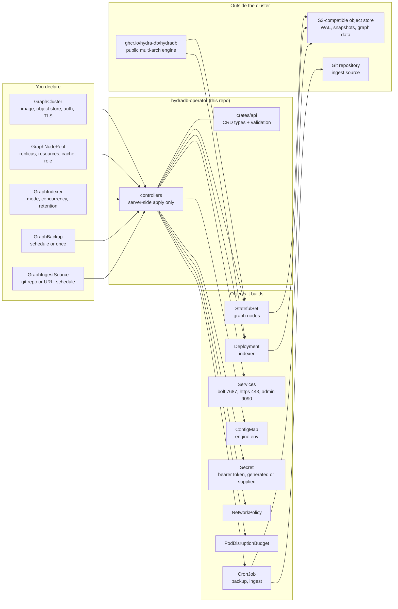

# HydraDB Operator

A [kube-rs](https://kube.rs/) operator that runs [HydraDB](https://github.com/hydra-db/hydradb) — an
object-storage-native distributed graph database — on Kubernetes.

The operator builds every child object in Rust and server-side-applies it. It never shells out to
`helm`, never resolves `:latest` at runtime, and never holds a credential: credentials stay in the
Secrets you point it at.

## Using it, and contributing

This operator is open source. You can use it for free, in any project, under the licence in
`LICENSE`.

Contributions are welcome, and so are issues. A bug report, a question or a pull request all
help, and none of them needs permission first.

One honest limit: this is maintained next to other work, so there is no promised timeline for a
review or a merge. Issues and pull requests are read, but they can wait longer than they would
in a project with paid maintainers. If something is urgent for you, say so in the issue and
explain why. That is the one thing that changes the order.

## How it fits together



The operator holds no state of its own. Every reconcile reads the custom resources, computes the
child objects, and server-side-applies them. Delete an object by hand and the next reconcile puts
it back. Change the CR and the children follow.

## Custom resources

API group `hydradb.kubexa.tech`, version `v1alpha1`, all namespaced:

| Kind | Short | Purpose |
|------|-------|---------|
| **GraphCluster** | `hgc` | One graph: image, object store, auth, TLS, ports, tuning, optional restore. |
| **GraphNodePool** | `hgnp` | A pool of graph nodes: size, resources, cache, role (writer/reader), optional HPA. |
| **GraphIndexer** | `hgi` | Index builder: build mode, concurrency, WAL-tail caps, retention of generations. |
| **GraphBackup** | `hgb` | Scheduled or one-shot copies of the graph's object-store data. |
| **GraphIngestSource** | `hgis` | Scheduled or webhook-triggered ingestion runs from a git repo or URL. |

## Quickstart

```sh
# CRDs only, if you manage the operator yourself
kubectl apply -f deploy/crds/

# or the whole thing from the Harbor oss project
helm install hydradb-operator oci://harbor.kubexa.tech/oss/hydradb-operator --version <version>
```

Then a minimal cluster — `image`, `graph` and `objectStore` are required; there is no hidden default
for any of them:

```yaml
apiVersion: hydradb.kubexa.tech/v1alpha1
kind: GraphCluster
metadata:
  name: example
  namespace: default
spec:
  image:
    repository: harbor.kubexa.tech/oss/hydradb
    tag: v0.1.0
  graph:
    namespace: tenant
    id: default
    database: default
    cellId: cell-0
  objectStore:
    explicit:
      bucket: hydradb-data
      credentialsSecretRef:
        name: hydradb-s3
---
apiVersion: hydradb.kubexa.tech/v1alpha1
kind: GraphNodePool
metadata:
  name: example-nodes
  namespace: default
spec:
  clusterRef:
    name: example
  replicas: 3
  cache:
    storage:
      emptyDir: {}
---
apiVersion: hydradb.kubexa.tech/v1alpha1
kind: GraphIndexer
metadata:
  name: example-indexer
  namespace: default
spec:
  clusterRef:
    name: example
  enabled: true
  replicas: 1
```

`kubectl hydradb status example`, `endpoints`, `logs`, `doctor`, `scale`, `backup` and `restore`
ship in the same image as the controller.

## Scope: what this operator is, and is not

The operator manages **the HydraDB storage engine** — the part that is published upstream. Check the
licence recorded in the upstream repository before you rely on any right to run, copy or modify it;
the terms have changed once already. Concretely, that engine provides: durable graph storage on SlateDB over S3-compatible
object storage, an OpenCypher query engine, GraphBLAS traversal with immutable index generations, and
Bolt (7687) plus an HTTPS query API.

It does **not** provide a semantic or retrieval layer. HydraDB's hosted product additionally markets
entity/relationship extraction, a retrieval orchestrator, hybrid semantic + BM25 retrieval and
reranking; **none of that is in the open-source repository** (there is no embedding, BM25, rerank or
entity-extraction code in it — its only "vector" type is the GraphBLAS FFI). This operator therefore
exposes engine knobs only, and its ingestion contract writes Cypher into the graph — there is no
vector or full-text store to write into.

Practical consequence: this project gives you a **self-hostable graph database**. If you need the
semantic retrieval layer, that is HydraDB's hosted service or SDK. Do not read any field in
`tuning` or `GraphIngestSource` as reaching past the engine — none of them do.

## Docs

- `docs/backup.md` — backup, restore and ingest contracts (the `HYDRADB_*` variables, safety
  ordering, webhook authentication).
- `docs/crd-*.md` — generated CRD reference.
- `docs/decisions/` — ADRs, including the proven dual-registry image push.
- `docs/backup.md` §4 — why there is no vector/BM25 store to ingest into.
- `CONTRIBUTING.md` — build, test, submit.
- `SECURITY.md` — how to report vulnerabilities.

## License

**This operator is Apache-2.0** (see [LICENSE](LICENSE)). That licence covers this repository only.
The operator links nothing from HydraDB and contains no HydraDB code: it deploys the operand image
you name at runtime, so no licence is mixed inside one artefact.

**HydraDB itself is not open source, and did not stay under the licence it shipped with.** The
creators have changed its terms. The earlier text here recorded AGPL-3.0 because that is what the
repository said when this operator was written; that statement no longer holds, and it is removed
rather than replaced with a guess. Read the licence file in the upstream repository for the current
terms, and read it before you plan around them.

### Where we stand

We disagree with the direction upstream has taken, and the README should say so rather than imply a
partnership that does not exist.

- **The licence is no longer an open-source licence in the sense the OSI defines.** A licence that
  forbids or restricts the uses an open-source licence must permit is not open source, however it is
  described in a README or a launch post.
- **The public repository is not a place where work happens.** It arrives as large periodic
  snapshots: whole trees pushed at once, with no development history to read, no issue discussion
  that shapes the code, and no review of outside contributions. That is a distribution channel
  dressed as a project. A code dump is not a community, and a snapshot is not a contribution.

This operator is separate from that. It is Apache-2.0, developed in the open in this repository, and
contributed to like any other project here. If you need the engine, you can install the image you
choose and manage it with this operator. If you need terms you can build a business on, read the
upstream licence carefully first.

Contributions to this operator are accepted under Apache-2.0 (inbound = outbound).
